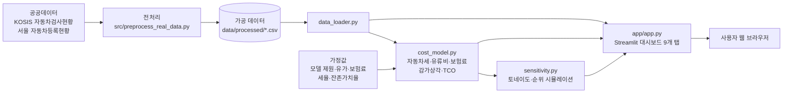

# 자동차 생애주기 분석 대시보드
### Car Lifecycle & Total Cost of Ownership Dashboard

> 내 차를 몇 년 타면, 총 얼마가 들까? 공공데이터로 계산해 보는 자동차 총소유비용(TCO) 분석

| 항목 | 내용 |
|---|---|
| 팀명 | **얼마나 탈까** |
| 작품명 | 자동차 생애 주기 분석 |
| 팀원 | 32237627 이운길 |
| 소속 | 단국대학교 소프트웨어학과 |
| GitHub | https://github.com/ungil0414/car-lifecycle-dashboard |

---

## 제출 자료

| 구분 | 위치 |
|---|---|
| 소스 코드 | [`app/`](app), [`src/`](src), [`tests/`](tests) |
| 실행 방법 | 아래 [실행 방법](#9-실행-방법) (`streamlit run app/app.py`) |
| 개발 문서 | 이 README, [`docs/`](docs) |
| 포스터 PDF | `docs/poster.pdf` |
| 프로젝트 결과보고서 PDF | `docs/report.pdf` |
| 시연 영상 | 업로드 후 이 줄에 YouTube 링크 기재 |

---

## 1. 프로젝트 개요

### 1-1. 개발 배경 및 필요성
자동차는 개인의 큰 소비 중 하나지만, "몇 년을 타야 이득인지", "타는 동안 돈이 총 얼마나 드는지",
"내 또래는 차를 얼마나 갖고 있는지"를 데이터로 확인하기는 어렵습니다.
중고차 사이트는 **시세**를, 제조사 사이트는 **신차 가격**을 보여줄 뿐, 보유 기간 동안의
**자동차세 + 유류비 + 보험료 + 감가상각**을 한 번에 합산해 비교해 주는 서비스는 드뭅니다.
또 계산에 들어가는 가정(연비·유가·감가율 등)이 바뀌어도 결론이 유지되는지 보여 주는 곳은 더 드뭅니다.

### 1-2. 개발 목표
공공데이터(KOSIS·서울 열린데이터광장 등)로 실제 사용 패턴을 분석하고, 이를 바탕으로
**보유 기간별 총소유비용(TCO)** 을 계산·비교하며, **가정이 흔들려도 결론이 유지되는지**까지 검증하는
대시보드를 만듭니다. 가계 재무 의사결정을 데이터로 지원한다는 점에서 소비자 금융 분석의 성격을 갖습니다.

### 1-3. 주요 기능
1. 차급별 평균 사용 기간(교체 주기)
2. 차급별 평균 누적주행거리
3. 연령대별 자동차 보유 현황
4. 차급·연료별 연간 유지비
5. **보유 기간별 TCO 계산 및 차급 비교**
6. **대표 모델(모닝·아반떼·투싼·스포티지·쏘나타·K5·그랜저) 간 TCO 비교**
7. **민감도 분석**: 가정(연비·유가·보험료·감가상각·주행거리)을 바꿔도 결론이 유지되는지 검증
8. 내 차와 평균값 비교

### 1-4. 기대 효과
- 차량 구매·교체 시점을 데이터로 판단하는 근거 제공 (예: 5년 vs 10년 보유 시 총비용 차이)
- 모델 간 차이가 "확실한 차이"인지 "가정에 따라 뒤집히는 차이"인지 구분해 과신 방지
- 계산 근거와 한계를 공개해 비슷한 분석을 재현·확장할 수 있는 기반 제공

---

## 2. 시스템 구조



데이터 흐름: 공공데이터 → 전처리(구간별 대수를 가중평균) → 계산 모델(TCO) → 민감도 분석 → 대시보드.
별도 서버·DB 없이 가공된 CSV와 Python 계산 로직만으로 동작합니다.

## 3. 사용 데이터

| 데이터 | 출처 | 활용 |
|---|---|---|
| 용도별 차종별 규모별 **차령별** 자동차검사현황 (2015~2024) | KOSIS, 한국교통안전공단 | 차급별 평균 사용연수 |
| 용도별 차종별 규모별 **누적주행거리별** 자동차검사현황 (2015~2024) | KOSIS, 한국교통안전공단 | 차급별 평균 주행거리 |
| 자동차등록현황(성별/연령별) (2023~2025) | 서울 열린데이터광장 | 연령대별 보유 현황 |
| 현대·기아 대표 모델 제원(배기량·복합연비) | 기아 공식 사이트, 카눈 제원 페이지 | 모델별 TCO |
| 자동차세 세율·차령 경감 | 지방세법 및 동법 시행령 | 자동차세 계산 |
| 전국 평균 유가 (휘발유·경유), 2026.09 | 오피넷(한국석유공사) | 유류비 계산 |
| 개인용 자동차보험 1대당 평균 보험료 (2025, 약 68만원) | 보험개발원 (언론 보도 인용) | 보험료 계산 |

> 📌 세율·경감률의 정확한 조문 번호는 발표 전에 위택스(wetax.go.kr) 또는 국가법령정보센터에서 확인해 보고서에 적을 것.

## 4. 계산 방법

### 4-1. 평균 사용연수 · 평균 주행거리
KOSIS는 "5~6년", "7~8년" 같은 **구간별 검사대수**만 제공합니다. 각 구간의 **중간값**을 대푯값으로 가정하고
검사대수를 가중치로 하는 **가중평균**을 직접 계산했습니다 (`src/preprocess_real_data.py`).

- 차령: `5~6년 → 5.5년`, …, `15년 이상 → 18년(가정)`
- 주행거리: `5만km 미만 → 25,000km`, …, `25만km 이상 → 300,000km(가정)`

### 4-2. 총소유비용(TCO) — `src/cost_model.py`

```
연간 비용(n년차) = 자동차세(n년차) + 유류비 + 보험료
TCO(N년 보유)    = 연간 비용의 N년 합계
```

- **자동차세** = 배기량 × cc당 세율 × (1 − 차령 경감률) × 1.3(지방교육세 30%)
  - cc당 세율: 1,000cc 이하 80원 / 1,600cc 이하 140원 / 초과 200원
  - 차령 경감률: 3년차 5%, 이후 매년 +5%p, 최대 50%(12년차 이상)
- **유류비** = 연간 주행거리 ÷ 연비 × 유가
  - 연간 주행거리 = 평균 누적주행거리 ÷ 평균 사용연수 (위 실제 데이터로 역산)

**가정 (공식 통계가 아닌 분석용 값)**
- 차급별 대표 배기량: 경형 998cc(모닝), 소형 1,598cc(아반떼), 중형 1,999cc(쏘나타), 대형 2,497cc(그랜저)
- 차급별 대표 연비: 경형 15.0 / 소형 13.5 / 중형 11.5 / 대형 9.5 km/L
- 보험료는 차급·연령·경력과 무관하게 전체 평균을 동일 적용 (차급별 공식 평균 미확인)
- 보유 기간 동안 세율·유가·연비가 변하지 않음

**제외 항목**: 정비·소모품비, 주차·통행료 (개인 편차가 커서 신뢰할 공식 평균 통계가 없음)

### 4-3. 모델별 TCO
차급 대표값 대신 실제 모델의 배기량·공식 복합연비(가솔린 기본 엔진, 중간 크기 타이어 기준)를 같은 식에 넣습니다 (`cost_model.MODEL_SPECS`).
**감가상각** = 신차가 × (구매 시점 잔존율 − 매각 시점 잔존율)을 더해 최종 TCO를 구합니다. 잔존가치율은 공개 참고자료 두 곡선을 낙관/비관 시나리오로 쓴 **가정**이며, 결과를 범위로 보여줍니다.
모델별 사용기간·주행거리 통계는 공공데이터에 없어, **연간 주행거리는 모델이 속한 차급(배기량 구분)의 평균값**을 썼습니다.
따라서 모델 간 차이는 자동차세(배기량)와 유류비(연비)에서만 생깁니다.

### 4-4. 민감도 분석 — `src/sensitivity.py`
TCO에는 공식 통계가 아닌 가정이 많아서, 결론이 가정에 얼마나 흔들리는지 확인했습니다.
- **토네이도**: 가정 하나만 ±20%(조정 가능) 바꿨을 때 TCO 변화량 → 어떤 가정이 가장 중요한지
- **무작위 시뮬레이션(1,000회)**: 유가는 공통, 연비·보험료·감가상각액·연간 주행거리는 모델마다 독립적으로 ±20% 범위에서 뽑아 모델 순위를 반복 계산 → 순위 유지 확률
  (모든 모델을 같은 방향으로만 흔들면 순위가 안 바뀌는 착시가 생기므로 모델별로 독립 변동)

**예시 결과 (5년 보유·새 차·휘발유·±20% 기준, 앱에서 조건 변경 가능)**
- 가장 영향이 큰 가정은 **감가상각액**, 그다음 연비·유가·주행거리, 보험료 영향은 가장 작음 (그랜저 기준)
- 모닝이 1위(가장 저렴)를 유지한 비율 약 96%, 그랜저가 꼴찌(가장 비쌈)를 유지한 비율 약 95%
- 반면 투싼·스포티지·쏘나타·K5 사이의 순위는 가정에 따라 자주 바뀜 (예: K5가 쏘나타보다 저렴할 확률 약 61%) → 중간 모델끼리는 "확실히 낫다"고 말하기 어려움
- 변동폭(±20%)과 균등분포는 분석자가 정한 가정이며, 가정 간 상관은 반영하지 않음

## 5. 데이터 한계

- '소형' 차급은 검사대수 표본이 약 5만대로 다른 차급(수십만~수백만 대)보다 훨씬 적고, 평균 사용연수(16.3년)가
  다른 차급보다 크게 높게 나옵니다. 최근 소형 승용차 판매 감소 영향으로 보이며 대표성이 낮을 수 있습니다.
- 연령대별 데이터는 **서울시 한정**이며 차급과 교차된 데이터가 아닌 "연령대별 등록대수"입니다.
  따라서 "연령대별 차급 선호"가 아니라 "연령대별 보유 현황"으로 활용했습니다.
- TCO는 정비비를 제외했고 중고 시세는 가정이므로 실제 체감 비용보다 낮게 나옵니다.

## 6. 기술 스택

Python · Pandas/NumPy · Plotly · Streamlit

## 7. 폴더 구조

```
car-lifecycle-dashboard/
├── .streamlit/config.toml          # 테마 설정
├── app/app.py                      # Streamlit 대시보드 (9개 탭, 첫 탭은 프로젝트 요약)
├── src/
│   ├── preprocess_real_data.py     # 원본 → 가공 데이터
│   ├── cost_model.py               # 자동차세·유류비·보험료·감가상각·TCO 계산 로직
│   ├── sensitivity.py              # 민감도 분석(토네이도, 순위 유지 시뮬레이션)
│   ├── data_loader.py              # 가공 데이터 로딩
│   └── sample_data.py              # 데이터 없을 때만 쓰는 대체 데이터
├── data/raw/                       # 원본 엑셀
├── data/processed/                 # 전처리 결과 CSV
├── tests/                          # 계산 로직 검증 테스트
├── docs/                           # 포스터·결과보고서 PDF 등 제출 문서
└── requirements.txt
```

## 8. 검증

- 모든 계산식은 손계산 값과 대조해 확인했고, 대시보드는 자동 테스트로 9개 탭 오류 여부를 점검했습니다.
- 가정이 많은 부분은 민감도 분석(4-4)으로 결과의 안정성을 따로 확인했습니다.

## 9. 실행 방법

```bash
pip install -r requirements.txt
python src/preprocess_real_data.py   # 원본 → 가공 데이터 (최초 1회 또는 원본 갱신 시)
streamlit run app/app.py
```
